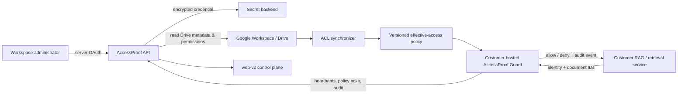

# Google Workspace + Drive V1 architecture

The API owns operator OAuth material and encrypts it through the configured secret backend. `web-v2` only starts the OAuth redirect and never receives Google access tokens, refresh tokens, client secrets, or Guard credentials. `apps/api/accessproof_api/acl_sync.py` computes the access input; `apps/api/accessproof_api/app.py` publishes versioned policy; `apps/guard/accessproof_guard` installs it locally and makes the request-time decision.

V1 production source creation is deliberately constrained to `google-drive`. The API rejects alternate providers and browser-posted source credentials before persistence. This keeps the shipping scope aligned with the release boundary.
